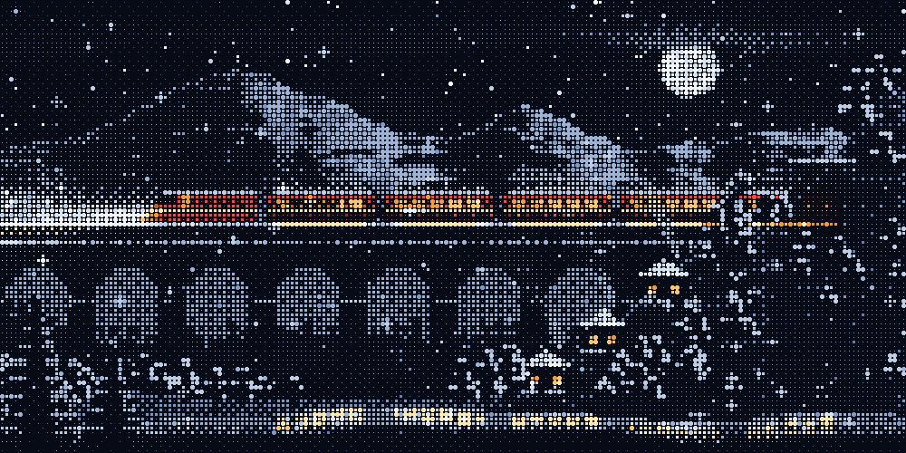

<p align="center">
  <a href="./ReadMe.md">RU</a> · <b>EN</b>
</p>

<p align="center">
  <picture>
    <source media="(prefers-color-scheme: dark)" srcset=".github/banner.dark.svg">
    
  </picture>
</p>

<p align="center">
  <picture>
    <source media="(prefers-reduced-motion: reduce)" srcset=".github/snow-train-loop.png">
    
  </picture>
</p>

<h3 align="center">backend · automation · infrastructure</h3>

<p align="center">
  <a href="https://t.me/gorkler"></a>
  <a href="mailto:vukkong@gmail.com"></a>
</p>

---

### `whoami`

Backend developer and automation engineer based in Barnaul, Russia.  
I build services with **Rust** and **Python**, automate routine with **n8n + LLM**, and ship to **Kubernetes** with observability.

```yaml
currently:
  - TouristHub — Rust/Axum, PostgreSQL, Redis, k8s, Prometheus/Grafana/Loki
  - WarThunderMOD — Subnautica 2 mod, logic only
  - RTK CRM — FastAPI/PostgreSQL, B2B CRM
  - n8n + LLM automations

open_to:
  - junior backend / automation / devops (remote)
  - freelance automation projects
```

### stack

<p>
  
  
  
  
  
  
  
  
  
  
  
</p>

### selected work

| project | what |
| --- | --- |
| **[TouristHub](https://github.com/N01Ta/TouristHub)** | Social network for tourists. 4 Rust/Axum services, 74 endpoints, 97 tests, PostgreSQL/Redis/S3, JWT/2FA, OpenAPI, Docker, Kubernetes, CI/CD, Prometheus/Grafana/Loki. Code on request. |
| **[WarThunderMOD](https://github.com/N01Ta/Subnautica2-WarThunderMOD)** | Subnautica 2 mod to spawn and arrange 3D models in-game. Used for War Thunder / GTA 5 RP integrations. Logic only — models are not included. |
| **[RTK CRM](https://github.com/N01Ta/rtk_crm)** | Internal B2B sales CRM: FastAPI, PostgreSQL, JWT auth, admin/user panels, requests, tariffs, training, chat, docs. 70+ users. Public, sanitized portfolio version. |
| **automation** | n8n workflows, LLM agents, parsers, API integrations. 350k+ profiles scraped. Private. |

### stats

<p align="center">
  <sub>Most work is in private repositories — the GitHub contribution graph below this README is the source of truth.</sub>
</p>
