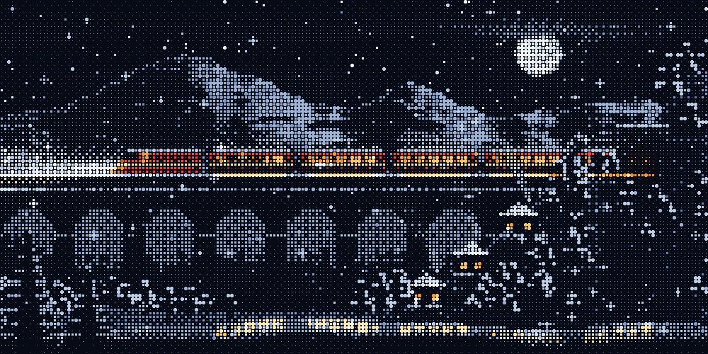
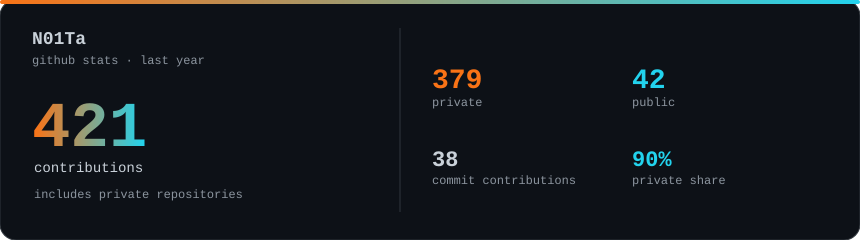

<p align="center">
  <b>RU</b> · <a href="./README.en.md">EN</a>
</p>

<p align="center">
  <picture>
    <source media="(prefers-color-scheme: dark)" srcset=".github/banner.dark.svg">
    
  </picture>
</p>

<p align="center">
  <picture>
    <source media="(prefers-reduced-motion: reduce)" srcset=".github/snow-train-loop.png">
    
  </picture>
</p>

<h3 align="center">бэкенд · автоматизация · инфраструктура</h3>

<p align="center">
  <a href="https://t.me/gorkler"></a>
  <a href="mailto:vukkong@gmail.com"></a>
</p>

---

### `кто я`

Бэкенд-разработчик и инженер по автоматизации из Барнаула.  
Пишу сервисы на **Rust** и **Python**, автоматизирую рутину через **n8n + LLM**, разворачиваю в **Kubernetes** с мониторингом.

```yaml
сейчас:
  - TouristHub — Rust/Axum, PostgreSQL, Redis, k8s, Prometheus/Grafana/Loki
  - WarThunderMOD — мод для Subnautica 2, только логика
  - RTK CRM — FastAPI/PostgreSQL, B2B CRM
  - n8n + LLM автоматизации

открыт к:
  - junior backend / automation / devops (удалённо)
  - фриланс-проектам по автоматизации
```

### стек

<p>
  
  
  
  
  
  
  
  
  
  
  
</p>

### избранные проекты

| проект | что это |
| --- | --- |
| **[TouristHub](https://github.com/N01Ta/TouristHub)** | Соцсеть для туристов. 4 сервиса на Rust/Axum, 74 эндпоинта, 97 тестов, PostgreSQL/Redis/S3, JWT/2FA, OpenAPI, Docker, Kubernetes, CI/CD, Prometheus/Grafana/Loki. Код — по запросу. |
| **[WarThunderMOD](https://github.com/N01Ta/Subnautica2-WarThunderMOD)** | Мод для Subnautica 2: спавн и расстановка 3D-моделей в игре. Использовался для интеграций с War Thunder / GTA 5 RP. Только логика — модели не включены. |
| **[RTK CRM](https://github.com/N01Ta/rtk_crm)** | Внутренняя B2B CRM для отдела продаж: FastAPI, PostgreSQL, JWT-авторизация, админ/пользовательские панели, заявки, тарифы, обучение, чат, документация. 70+ пользователей. Публичная санированная версия. |
| **автоматизация** | n8n-процессы, LLM-агенты, парсеры, API-интеграции. 350k+ профилей; автоматизация рутины. Приватно. |

### статистика

<p align="center">
  
</p>

